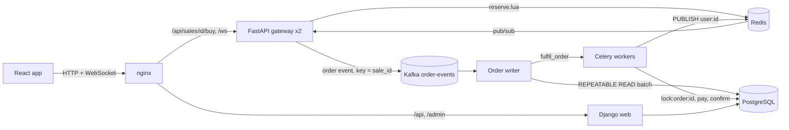

# FlashCore — Distributed Flash Sale Engine

Django · FastAPI · React · PostgreSQL · Redis · Kafka · Celery · WebSockets · Docker

A flash-sale backend that takes thousands of buy requests per second for a limited stock and
**never oversells**: Redis decides who gets a unit, Kafka records the purchase durably,
PostgreSQL stores it in REPEATABLE READ transactions, Celery fulfils it, and a WebSocket
tells the buyer.

- Design and decisions: [docs/ARCHITECTURE.md](docs/ARCHITECTURE.md)
- Build plan: [docs/PLAN.md](docs/PLAN.md)



## How a buy works

1. **Gateway (sync, ~ms):** verify the JWT locally → `reserve.lua` atomically checks the buyer set
   and decrements stock → produce the event to Kafka (`acks=all`, idempotent) → `202 RESERVED`.
   If Kafka fails the reservation is released and the client gets `503 try_again`.
2. **Order writer:** consumes batches, inserts orders with `ON CONFLICT DO NOTHING` and decrements
   PostgreSQL stock with a conditional `UPDATE` in one REPEATABLE READ transaction (retried on
   SQLSTATE 40001). Kafka offsets are committed only after the DB commit.
3. **Celery:** `fulfil_order` takes a per-order Redis lock, runs a mock payment, marks the order
   CONFIRMED (or FAILED and returns the unit), then publishes to `user:{id}`.
4. **WebSocket:** each gateway process forwards `user:{id}` messages to that user and broadcasts
   live stock at most twice a second.
5. **Reconcile (every 60 s):** checks `remaining + sold == total`, lowers Redis if it is ever
   above the DB, and re-sends orders stuck in PENDING.

## Quick start

```powershell
Copy-Item .env.example .env                      # first time only
docker compose up -d --build                     # ~11 containers; first build takes a few minutes
docker compose ps                                # wait until everything is healthy
docker compose exec web python manage.py createsuperuser
docker compose exec web python manage.py create_demo --stock 100 --users 20
```

Open **http://localhost**, log in as `demo1` / `demo12345`, and open the sale. Open a second
browser (or a private window) as `demo2` and watch the stock drop live in both.
Admin: **http://localhost/admin** ("Start sale" / "End sale" actions, live Redis stock column).

## Deploy (free)

React app on **Vercel**; the backend stack on an **Oracle Cloud Always Free** VM with HTTPS from
Caddy + Let's Encrypt. Both cost nothing. Full guide: [docs/DEPLOY.md](docs/DEPLOY.md).

```powershell
powershell -ExecutionPolicy Bypass -File deploy/deploy_vm.ps1 -Server ubuntu@<vm-ip>          # backend
powershell -ExecutionPolicy Bypass -File deploy/deploy_frontend.ps1 -ApiUrl https://<vm-ip-with-dashes>.sslip.io
powershell -ExecutionPolicy Bypass -File deploy/deploy_vm.ps1 -Server ubuntu@<vm-ip> -Cors https://<project>.vercel.app
```

## Testing everything (in this order)

| # | What | Command |
|---|---|---|
| 1 | Infrastructure (Postgres, Redis, Kafka, topic, volumes) | `powershell -ExecutionPolicy Bypass -File scripts/check_infra.ps1 -CheckPersistence` |
| 2 | Django tests: models, constraints, JWT, sale control, order writer, Repeatable Read + phantom-read demo, Celery + locks, reconcile | `docker compose exec web pytest -v` |
| 3 | Gateway tests: 1000-vs-100 oversell, tokens, Kafka events, WebSocket | `docker compose exec gateway pytest -v -s` |
| 4 | Kafka-down chaos test (stops Kafka) | `powershell -ExecutionPolicy Bypass -File scripts/run_chaos_tests.ps1` |
| 5 | End to end inside Docker (200 buys → all fulfilled → invariants) | `docker compose exec web python manage.py smoke_test --buys 200` |
| 6 | End to end through nginx with WebSockets, 20 users, 2 gateway replicas | `docker compose exec web python manage.py create_demo --stock 100 --users 20` then `powershell -ExecutionPolicy Bypass -File scripts/smoke.ps1 -SaleId <id>` |
| 7 | Chaos: 300 req/s while restarting the order writer, killing Celery, restarting Redis | `powershell -ExecutionPolicy Bypass -File scripts/chaos_test.ps1` |
| 8 | Load: N req/s for 60 s, every request a real write | `powershell -ExecutionPolicy Bypass -File loadtest/run_k6.ps1 -Scenario throughput -Rate 1000 -Seconds 60 -PauseCelery` |
| 9 | Hot item: 5,000 req/s against 1,000 units → exactly 1,000 sold | `powershell -ExecutionPolicy Bypass -File loadtest/run_k6.ps1 -Scenario hot_item` |

Any time: `docker compose exec web python manage.py check_invariants`.

### Load-test settings

Restart the stack with load-test settings before steps 8–9 (more gateway processes, fast mock
payments):

```powershell
$env:GATEWAY_WORKERS = 3; $env:GATEWAY_REPLICAS = 2; $env:MOCK_PAYMENT_DELAY_MS = 5; $env:CELERY_CONCURRENCY = 8
docker compose up -d
powershell -ExecutionPolicy Bypass -File loadtest/run_k6.ps1 -Scenario throughput -Rate 1000 -Seconds 60 -PauseCelery
```

`-PauseCelery` stops the Celery worker during the burst and lets it drain the backlog afterwards.
On one machine fulfilment otherwise competes with the write path for the same CPUs; in
production the workers run elsewhere. `loadtest/results/*-docker-stats.csv` shows which container
was busiest; `docker compose logs gateway | Select-String "slow buy"` shows whether slow buys
waited on Redis or on the Kafka ack.

## Results (measured 2026-10-02)

**Machine:** one laptop, AMD Ryzen 5 7535HS (6 cores / 12 threads), Windows 11, Docker Desktop
(WSL2, 12 CPUs, 7.4 GiB). All 11 services **and** the k6 load generator run on it, through nginx.

| Scenario (k6, through nginx) | Achieved | p50 | p95 | p99 | Errors | Integrity |
|---|---|---|---|---|---|---|
| 1,000 req/s for 30 s | 1,000 req/s | 18 ms | 43 ms | 80 ms | 0 | all 30,000 orders stored + fulfilled |
| 1,500 req/s for 60 s | 1,451 req/s | 23 ms | 512 ms | 866 ms | 0 | all 87,474 orders stored + fulfilled |
| 2,000 req/s for 30 s ¹ | 1,997 req/s | 25 ms | 166 ms | 276 ms | 0 | all 59,945 orders stored + fulfilled |
| 5,000 req/s offered, 20 s (saturation) | **2,343 req/s max** | 660 ms | 1.3 s | 4.4 s | 0 | all orders stored + fulfilled |
| hot item: 5,000 req/s offered, 1,000 units | 2,026 req/s | – | – | – | 0 | **exactly 1,000 sold, 0 oversell** |
| chaos: 300 req/s, 90 s, restarts ² | 300 req/s | 16 ms | – | – ³ | 125 × 503 | 0 lost, 0 duplicates, 0 double charges |
| single buy, no load (inside Docker) | – | 24 ms | – | 29 ms | 0 | – |

¹ measured before the Kafka poll-thread fix, so not directly comparable.
² order writer restarted, Celery worker `kill -9`'d and restarted, Redis restarted mid-run.
³ p99 is dominated by the seconds while Redis is restarting.

**Honest summary:** on this laptop the write path sustains ~1,000 req/s with p99 ≈ 80 ms and
tops out at ~2,300 req/s with zero errors; the **5,000 req/s / p99 < 50 ms target was not
reached** here. Above ~1,000 req/s the tail is dominated by host-level stalls (Windows + Docker
VM + 11 containers + k6 sharing 6 cores); at saturation the CPUs are full (gateways ~2.5 cores
each, k6 ~2–3.5, nginx ~0.9, order writer ~0.8). Every run kept every guarantee: no oversell,
no lost or duplicate order, nobody charged twice.

## What the testing found (and fixed)

| Found by | Problem | Fix |
|---|---|---|
| chaos test | 27 of 23,773 orders charged twice: worker killed after paying, before the DB commit; Celery redelivered | payment idempotency key = order id (like Stripe's `Idempotency-Key`) |
| chaos test | Redis restart → 500s → nginx marked both gateway replicas down → 3,200 × 502 | Redis errors → clean 503; nginx `max_fails=5 fail_timeout=2s` |
| chaos test | Celery fulfilled ~13 orders/s (threads pool at prefetch 1) | prefork pool: ~95/s at 100 ms mock payments |
| k6 + `pg_stat_database` | Celery opened a new PostgreSQL connection per task (160/s, postgres at 4 cores) | `CELERY_DB_REUSE_MAX` → 1 connection/s, postgres 0.6 cores |
| k6 + benchmark | aiokafka cost ~1 ms CPU per message, half the gateway's CPU | confluent-kafka (librdkafka): 0.17 ms |
| docker stats | tiny Kafka batches: broker at ~2 cores | `linger.ms=15`, lz4 |
| slow-request log | health probe inside the Kafka poll thread delayed every ack | own thread: p99 at 1,000 req/s 468 → 80 ms |
| nginx error log | keep-alive race (uvicorn 5 s < nginx 60 s) reset connections | uvicorn `--timeout-keep-alive 75` |

## Useful commands

```powershell
docker compose logs -f gateway order-writer celery-worker      # JSON lines
docker compose logs order-writer celery-worker | Select-String <order_id>
docker compose exec redis redis-cli get sale:1:stock
docker compose exec postgres psql -U flashcore -d flashcore -c "select status, count(*) from orders group by 1"
docker compose down            # keeps data
docker compose down -v         # wipes Postgres, Redis and Kafka data
```

## Project layout

```
core/       Django: models, admin, JWT, read APIs, order writer, Celery tasks, management commands
gateway/    FastAPI: buy endpoint, Lua scripts, Kafka producer, WebSocket gateway
frontend/   React (Vite)
nginx/      reverse proxy + React build
scripts/    infra check, smoke, load, chaos (PowerShell + Python)
loadtest/   k6 script and runner
deploy/     free deployment: VM setup over SSH, Caddy, Vercel frontend, Cloudflare tunnel
docs/       architecture spec, build plan, deployment guide
```

## Ports

| Service | URL |
|---|---|
| App (nginx) | http://localhost |
| Django (direct) | http://localhost:8000 |
| PostgreSQL | localhost:5432 |
| Redis | localhost:6379 |
| Kafka (external listener) | localhost:9094 |
