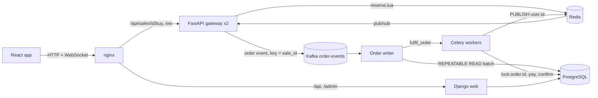

# FlashCore — Distributed Flash Sale Engine

Django · FastAPI · React · PostgreSQL · Redis · Kafka · Celery · WebSockets · Docker

A flash-sale backend that takes thousands of buy requests per second for a limited stock and
**never oversells**: Redis decides who gets a unit, Kafka records the purchase durably,
PostgreSQL stores it in REPEATABLE READ transactions, Celery fulfils it, and a WebSocket
tells the buyer.

- Design and decisions: [docs/ARCHITECTURE.md](docs/ARCHITECTURE.md)
- Build plan: [docs/PLAN.md](docs/PLAN.md)



## How a buy works

1. **Gateway (sync, ~ms):** verify the JWT locally → `reserve.lua` atomically checks the buyer set
   and decrements stock → produce the event to Kafka (`acks=all`, idempotent) → `202 RESERVED`.
   If Kafka fails the reservation is released and the client gets `503 try_again`.
2. **Order writer:** consumes batches, inserts orders with `ON CONFLICT DO NOTHING` and decrements
   PostgreSQL stock with a conditional `UPDATE` in one REPEATABLE READ transaction (retried on
   SQLSTATE 40001). Kafka offsets are committed only after the DB commit.
3. **Celery:** `fulfil_order` takes a per-order Redis lock, runs a mock payment, marks the order
   CONFIRMED (or FAILED and returns the unit), then publishes to `user:{id}`.
4. **WebSocket:** each gateway process forwards `user:{id}` messages to that user and broadcasts
   live stock at most twice a second.
5. **Reconcile (every 60 s):** checks `remaining + sold == total`, lowers Redis if it is ever
   above the DB, and re-sends orders stuck in PENDING.

## Quick start

```powershell
Copy-Item .env.example .env                      # first time only
docker compose up -d --build                     # ~11 containers; first build takes a few minutes
docker compose ps                                # wait until everything is healthy
docker compose exec web python manage.py createsuperuser
docker compose exec web python manage.py create_demo --stock 100 --users 20
```

Open **http://localhost**, log in as `demo1` / `demo12345`, and open the sale. Open a second
browser (or a private window) as `demo2` and watch the stock drop live in both.
Admin: **http://localhost/admin** ("Start sale" / "End sale" actions, live Redis stock column).

## Testing everything (in this order)

| # | What | Command |
|---|---|---|
| 1 | Infrastructure (Postgres, Redis, Kafka, topic, volumes) | `powershell -ExecutionPolicy Bypass -File scripts/check_infra.ps1 -CheckPersistence` |
| 2 | Django tests: models, constraints, JWT, sale control, order writer, Repeatable Read + phantom-read demo, Celery + locks, reconcile | `docker compose exec web pytest -v` |
| 3 | Gateway tests: 1000-vs-100 oversell, tokens, Kafka events, WebSocket | `docker compose exec gateway pytest -v -s` |
| 4 | Kafka-down chaos test (stops Kafka) | `powershell -ExecutionPolicy Bypass -File scripts/run_chaos_tests.ps1` |
| 5 | End to end inside Docker (200 buys → all fulfilled → invariants) | `docker compose exec web python manage.py smoke_test --buys 200` |
| 6 | End to end through nginx with WebSockets, 20 users, 2 gateway replicas | `docker compose exec web python manage.py create_demo --stock 100 --users 20` then `powershell -ExecutionPolicy Bypass -File scripts/smoke.ps1 -SaleId <id>` |
| 7 | Chaos: 300 req/s while restarting the order writer, killing Celery, restarting Redis | `powershell -ExecutionPolicy Bypass -File scripts/chaos_test.ps1` |
| 8 | Load: 5,000 req/s for 60 s, every request a real write | `powershell -ExecutionPolicy Bypass -File loadtest/run_k6.ps1 -Scenario throughput` |
| 9 | Hot item: 5,000 req/s against 1,000 units → exactly 1,000 sold | `powershell -ExecutionPolicy Bypass -File loadtest/run_k6.ps1 -Scenario hot_item` |

Any time: `docker compose exec web python manage.py check_invariants`.

### Load-test settings

Restart the stack with load-test settings before step 8 (more gateway processes, fast mock
payments so Celery keeps up):

```powershell
$env:GATEWAY_WORKERS = 3; $env:GATEWAY_REPLICAS = 2; $env:MOCK_PAYMENT_DELAY_MS = 5; $env:CELERY_CONCURRENCY = 32
docker compose up -d
```

If the target is missed, `loadtest/results/*-docker-stats.csv` shows which container hit 100% CPU.
Change one thing at a time and re-run.

## Results

Fill in with **measured** numbers only (from `loadtest/results/`).

| Scenario | Target | Achieved req/s | p50 | p95 | p99 | Errors | Oversold |
|---|---|---|---|---|---|---|---|
| throughput (1M stock, 60 s) | 5,000 req/s, p99 < 50 ms | – | – | – | – | – | – |
| hot_item (1,000 stock, 20 s) | 0 oversell | – | – | – | – | – | – |
| chaos (300 req/s, 90 s) | invariant holds | – | – | – | – | – | – |

Machine: _CPU, RAM, Docker Desktop CPU/memory limits, date_.

## Useful commands

```powershell
docker compose logs -f gateway order-writer celery-worker      # JSON lines
docker compose logs order-writer celery-worker | Select-String <order_id>
docker compose exec redis redis-cli get sale:1:stock
docker compose exec postgres psql -U flashcore -d flashcore -c "select status, count(*) from orders group by 1"
docker compose down            # keeps data
docker compose down -v         # wipes Postgres, Redis and Kafka data
```

## Project layout

```
core/       Django: models, admin, JWT, read APIs, order writer, Celery tasks, management commands
gateway/    FastAPI: buy endpoint, Lua scripts, Kafka producer, WebSocket gateway
frontend/   React (Vite)
nginx/      reverse proxy + React build
scripts/    infra check, smoke, load, chaos (PowerShell + Python)
loadtest/   k6 script and runner
docs/       architecture spec and build plan
```

## Ports

| Service | URL |
|---|---|
| App (nginx) | http://localhost |
| Django (direct) | http://localhost:8000 |
| PostgreSQL | localhost:5432 |
| Redis | localhost:6379 |
| Kafka (external listener) | localhost:9094 |
