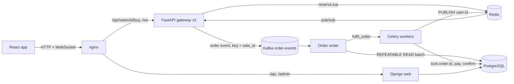

# FlashCore — Distributed Flash Sale Engine

[](https://github.com/jayasuriyasr/flashcore/actions/workflows/ci.yml)

Django · FastAPI · React · PostgreSQL · Redis · Kafka · Celery · WebSockets · Docker

A flash-sale backend that takes thousands of buy requests per second for a limited stock and
**never oversells**: Redis decides who gets a unit, Kafka records the purchase durably,
PostgreSQL stores it in REPEATABLE READ transactions, Celery fulfils it, and a WebSocket
tells the buyer.

- Design and decisions: [docs/ARCHITECTURE.md](docs/ARCHITECTURE.md)
- Trade-offs, failure modes, scaling, and "why not just PostgreSQL?": [docs/SCALING.md](docs/SCALING.md)
- Deployment: [docs/DEPLOY.md](docs/DEPLOY.md)
- Build plan: [docs/PLAN.md](docs/PLAN.md)



## How a buy works

1. **Gateway (sync, ~ms):** verify the JWT locally → `reserve.lua` atomically checks the buyer set
   and decrements stock → produce the event to Kafka (`acks=all`, idempotent) → `202 RESERVED`.
   No ack within 2 s → `503 try_again`, and the unit stays reserved until Kafka's client reports the
   real outcome (written late → the order proceeds; gave up → the unit goes back on sale).
2. **Order writer:** consumes batches, inserts orders with `ON CONFLICT DO NOTHING` and decrements
   PostgreSQL stock with a conditional `UPDATE` in one REPEATABLE READ transaction (retried on
   SQLSTATE 40001). Kafka offsets are committed only after the DB commit.
3. **Celery:** `fulfil_order` takes a per-order Redis lock, runs a mock payment, marks the order
   CONFIRMED (or FAILED and returns the unit), then publishes to `user:{id}`.
4. **WebSocket:** each gateway process forwards `user:{id}` messages to that user and broadcasts
   live stock at most twice a second.
5. **Reconcile (every 60 s):** checks `remaining + sold == total`, lowers Redis if it is ever
   above the DB, and re-sends orders stuck in PENDING.

## Quick start

```powershell
Copy-Item .env.example .env                      # first time only
docker compose up -d --build                     # ~11 containers; first build takes a few minutes
docker compose ps                                # wait until everything is healthy
docker compose exec web python manage.py createsuperuser
docker compose exec web python manage.py create_demo --stock 100 --users 20
```

Linux, macOS or Git Bash: `make up`, `make demo`, `make test` (see the [Makefile](Makefile)).

Open **http://localhost**, log in as `demo1` / `demo12345`, and open the sale. Open a second
browser (or a private window) as `demo2` and watch the stock drop live in both.
Admin: **http://localhost/admin** ("Start sale" / "End sale" actions, live Redis stock column).

## Deploy (free)

React app on **Vercel**; the backend stack on an **Oracle Cloud Always Free** VM with HTTPS from
Caddy + Let's Encrypt. Both cost nothing. Full guide: [docs/DEPLOY.md](docs/DEPLOY.md).

```powershell
powershell -ExecutionPolicy Bypass -File deploy/deploy_vm.ps1 -Server ubuntu@<vm-ip>          # backend
powershell -ExecutionPolicy Bypass -File deploy/deploy_frontend.ps1 -ApiUrl https://<vm-ip-with-dashes>.sslip.io
powershell -ExecutionPolicy Bypass -File deploy/deploy_vm.ps1 -Server ubuntu@<vm-ip> -Cors https://<project>.vercel.app
```

## Testing everything (in this order)

| # | What | Command |
|---|---|---|
| 1 | Infrastructure (Postgres, Redis, Kafka, topic, volumes) | `powershell -ExecutionPolicy Bypass -File scripts/check_infra.ps1 -CheckPersistence` |
| 2 | Django tests: models, constraints, JWT, sale control, order writer, Repeatable Read + phantom-read demo, Celery + locks, reconcile | `docker compose exec web pytest -v` |
| 3 | Gateway tests: 1000-vs-100 oversell, tokens, Kafka events, WebSocket | `docker compose exec gateway pytest -v -s` |
| 4 | Kafka-down chaos test (stops Kafka) | `powershell -ExecutionPolicy Bypass -File scripts/run_chaos_tests.ps1` |
| 5 | End to end inside Docker (200 buys → all fulfilled → invariants) | `docker compose exec web python manage.py smoke_test --buys 200` |
| 6 | End to end through nginx with WebSockets, 20 users, 2 gateway replicas | `docker compose exec web python manage.py create_demo --stock 100 --users 20` then `powershell -ExecutionPolicy Bypass -File scripts/smoke.ps1 -SaleId <id>` |
| 7 | Chaos: 300 req/s while restarting the order writer, killing Celery, restarting Redis | `powershell -ExecutionPolicy Bypass -File scripts/chaos_test.ps1` |
| 8 | Load: N req/s for 60 s, every request a real write | `powershell -ExecutionPolicy Bypass -File loadtest/run_k6.ps1 -Scenario throughput -Rate 1000 -Seconds 60 -PauseCelery` |
| 9 | Hot item: 5,000 req/s against 1,000 units → never more than 1,000 sold (a unit whose payment fails goes back on sale and is bought again) | `powershell -ExecutionPolicy Bypass -File loadtest/run_k6.ps1 -Scenario hot_item` |
| 10 | Chaos: PostgreSQL stopped for 30 s under load → buys still accepted, every order written afterwards | `powershell -ExecutionPolicy Bypass -File scripts/chaos_test.ps1 -Scenario postgres-down` |
| 11 | Chaos: Kafka brokers `kill -9`'d under load on the replicated cluster → no acknowledged order lost | `docker compose -f docker-compose.yml -f docker-compose.ha.yml up -d` then `powershell -ExecutionPolicy Bypass -File scripts/chaos_test.ps1 -Scenario kafka-ha` |
| 12 | PostgreSQL-only baseline: its own correctness test, then the same load test | `docker compose -f docker-compose.yml -f docker-compose.baseline.yml up -d --build`, `docker compose -f docker-compose.yml -f docker-compose.baseline.yml exec baseline pytest`, `powershell -ExecutionPolicy Bypass -File loadtest/run_k6.ps1 -Target baseline -Rate 1000 -Seconds 30` |

**CI** ([.github/workflows/ci.yml](.github/workflows/ci.yml)) runs steps 2–5 on every push, on a clean
Ubuntu runner: it builds the whole stack and runs [scripts/ci.sh](scripts/ci.sh), the same script you can
run locally (`make ci`, or `make ci-chaos` to include step 4).

Any time: `docker compose exec web python manage.py check_invariants`.

**Last full run (2026-11-15):** all 12 steps passed. Infra + persistence; Django 77/77; gateway 28/28
+ 3 chaos tests; `scripts/ci.sh` end to end (exit 0); 200-buy smoke; 20/20 WebSocket users through nginx;
three chaos scenarios (services, PostgreSQL down, Kafka brokers killed: 0 lost, 0 duplicates, 0 double
charges in each); throughput 1,000 req/s (p99 45.5 ms); hot item exactly 1,000/1,000 sold; baseline 2/2 and
its load test. Prometheus scraped both gateway replicas and Django, and the Grafana dashboard showed the
run. Production mode
(`docker-compose.prod.yml` + Caddy on `https://localhost`) was checked too: HTTP→HTTPS redirect, `DEBUG` off,
CORS allow-list on Django and the gateway, admin CSRF over HTTPS, buy + WebSocket through Caddy,
`check --deploy` clean.

### Load-test settings

Restart the stack with load-test settings before steps 8–9 (more gateway processes, fast mock
payments):

```powershell
$env:GATEWAY_WORKERS = 3; $env:GATEWAY_REPLICAS = 2; $env:MOCK_PAYMENT_DELAY_MS = 5; $env:CELERY_CONCURRENCY = 8
docker compose up -d
powershell -ExecutionPolicy Bypass -File loadtest/run_k6.ps1 -Scenario throughput -Rate 1000 -Seconds 60 -PauseCelery
```

`-PauseCelery` stops the Celery worker during the burst and lets it drain the backlog afterwards.
On one machine fulfilment otherwise competes with the write path for the same CPUs; in
production the workers run elsewhere. `loadtest/results/*-docker-stats.csv` shows which container
was busiest; `docker compose logs gateway | Select-String "slow buy"` shows whether slow buys
waited on Redis or on the Kafka ack.

## Results (measured 2026-10-02, re-measured 2026-10-28 and 2026-11-15)

**Machine:** one laptop, AMD Ryzen 5 7535HS (6 cores / 12 threads), Windows 11, Docker Desktop
(WSL2, 12 CPUs, 7.4 GiB). All 11 services **and** the k6 load generator run on it, through nginx.

| Scenario (k6, through nginx) | Achieved | p50 | p95 | p99 | Errors | Integrity |
|---|---|---|---|---|---|---|
| 1,000 req/s for 30 s (2026-11-15) | 1,000 req/s | 14.6 ms | 22.5 ms | **45.5 ms** | 0 | all 30,000 orders stored + fulfilled |
| same, on 3 Kafka brokers (replication 3) | 999 req/s | 18.6 ms | 49.0 ms | 94.7 ms | 0 | all 30,001 orders stored + fulfilled |
| 1,000 req/s for 60 s (2026-10-28) | 1,000 req/s | 14.5 ms | 21.4 ms | **57.4 ms** | 0 | all 60,001 orders stored + fulfilled |
| 1,000 req/s for 30 s | 1,000 req/s | 18 ms | 43 ms | 80 ms | 0 | all 30,000 orders stored + fulfilled |
| 1,500 req/s for 60 s | 1,451 req/s | 23 ms | 512 ms | 866 ms | 0 | all 87,474 orders stored + fulfilled |
| 2,000 req/s for 30 s ¹ | 1,997 req/s | 25 ms | 166 ms | 276 ms | 0 | all 59,945 orders stored + fulfilled |
| 5,000 req/s offered, 20 s (saturation) | **2,343 req/s max** | 660 ms | 1.3 s | 4.4 s | 0 | all orders stored + fulfilled |
| hot item: 5,000 req/s offered, 1,000 units | 2,026 req/s | – | – | – | 0 | **exactly 1,000 sold, 0 oversell** |
| chaos: 300 req/s, 90 s, restarts ² | 300 req/s | 16 ms | – | – ³ | 125 × 503 | 0 lost, 0 duplicates, 0 double charges |
| single buy, no load (inside Docker) | – | 24 ms | – | 29 ms | 0 | – |

¹ measured before the Kafka poll-thread fix, so not directly comparable.
² order writer restarted, Celery worker `kill -9`'d and restarted, Redis restarted mid-run.
³ p99 is dominated by the seconds while Redis is restarting.

**Honest summary:** on this laptop the write path sustains ~1,000 req/s with p99 between 45 and
80 ms depending on the run (the latest was 45.5 ms, under the 50 ms target; two earlier ones were
not) and tops out at ~2,300 req/s with zero errors. **5,000 req/s was not reached** here. Above ~1,000 req/s the tail is dominated by host-level stalls (Windows + Docker
VM + 11 containers + k6 sharing 6 cores); at saturation the CPUs are full (gateways ~2.5 cores
each, k6 ~2–3.5, nginx ~0.9, order writer ~0.8). Every run kept every guarantee: no oversell,
no lost or duplicate order, nobody charged twice.

## Why not just PostgreSQL?

The simplest correct design is one transaction per buy (`INSERT` the order, `UPDATE … SET remaining =
remaining - 1 WHERE remaining > 0`). It is built in [baseline/](baseline/app/main.py), passes its own
oversell test, and was measured with the same k6 script through the same nginx (2026-11-15):

| One sale, every request a new buyer | 1,000 buys/s offered | Most it could do |
|---|---|---|
| **FlashCore** (1 Kafka broker) | 1,000/s, **p99 45.5 ms** | **2,303/s** |
| **FlashCore** (3 Kafka brokers, replication 3) | 999/s, p99 94.7 ms | **1,987/s** |
| PostgreSQL only, durable commits | 377/s, p99 22.7 s, half the requests never started | 363/s |
| PostgreSQL only, `synchronous_commit=off` | 800/s, p99 6.3 s | 856/s |

Every buyer of a sale updates the same row, so PostgreSQL makes them queue on that row's lock.
FlashCore decides in Redis, records in Kafka, and touches the hot row once per batch of up to 500
orders. For a sale that needs only a few hundred buys per second the baseline is the better choice.
The reasoning, the durability caveat, failure modes and the scaling path are in
[docs/SCALING.md](docs/SCALING.md).

## Replicated Kafka (HA mode)

```powershell
docker compose -f docker-compose.yml -f docker-compose.ha.yml up -d      # 3 brokers instead of 1
powershell -ExecutionPolicy Bypass -File scripts/chaos_test.ps1 -Scenario kafka-ha
docker compose up -d --remove-orphans                                     # back to the single broker
```

`order-events` is stored on all 3 brokers and a write is acknowledged once 2 have it (`acks=all`,
`min.insync.replicas=2`). Measured: two brokers `kill -9`'d one after the other during 27,000 buys
at 300/s → 26,934 accepted, 66 answered "try again" (their reservations were kept and their orders
written once leaders were re-elected), **27,000 orders stored, 0 lost, 0 duplicates**.

## Observability

```powershell
docker compose --profile observability up -d
```

- **Grafana:** http://localhost:3000 (dashboard "FlashCore", no login needed to view)
- **Prometheus:** http://localhost:9090 (`PROMETHEUS_PORT` / `GRAFANA_PORT` in `.env` if a port is taken)

The dashboard shows buys/s by outcome, p50/p95/p99 inside the gateway, p99 split into the Redis
reserve and the Kafka ack, orders by status and fulfilled/s, order-writer lag (events in Kafka not
yet in PostgreSQL), orders stuck in PENDING, and stock per live sale in PostgreSQL vs Redis. Metrics
are served on the Docker network only; nginx doesn't route them.

## Dependencies

`requirements*.txt` state the allowed ranges; `constraints.txt` next to each pins every package
(direct and transitive) to the versions the tests ran with, and the images install with
`pip install -r requirements-dev.txt -c constraints.txt`. To update: regenerate with
`uv pip compile requirements-dev.txt --universal --python-version 3.12 -o constraints.txt` in
`core/`, `gateway/` and `baseline/` (and `requirements.txt` in `scripts/`), rebuild, and run the tests.

## What the testing found (and fixed)

| Found by | Problem | Fix |
|---|---|---|
| chaos test | 27 of 23,773 orders charged twice: worker killed after paying, before the DB commit; Celery redelivered | payment idempotency key = order id (like Stripe's `Idempotency-Key`) |
| chaos test | Redis restart → 500s → nginx marked both gateway replicas down → 3,200 × 502 | Redis errors → clean 503; nginx `max_fails=5 fail_timeout=2s` |
| chaos test | Celery fulfilled ~13 orders/s (threads pool at prefetch 1) | prefork pool: ~95/s at 100 ms mock payments |
| k6 + `pg_stat_database` | Celery opened a new PostgreSQL connection per task (160/s, postgres at 4 cores) | `CELERY_DB_REUSE_MAX` → 1 connection/s, postgres 0.6 cores |
| k6 + benchmark | aiokafka cost ~1 ms CPU per message, half the gateway's CPU | confluent-kafka (librdkafka): 0.17 ms |
| docker stats | tiny Kafka batches: broker at ~2 cores | `linger.ms=15`, lz4 |
| slow-request log | health probe inside the Kafka poll thread delayed every ack | own thread: p99 at 1,000 req/s 468 → 80 ms |
| nginx error log | keep-alive race (uvicorn 5 s < nginx 60 s) reset connections | uvicorn `--timeout-keep-alive 75` |
| code review | starting a sale set the stock, *then* rebuilt the buyers set: buyers in that gap could reserve twice (DB rejected the 2nd order, so Redis undersold) | `start_sale.lua` does both atomically |
| code review | an order update sent while the browser's WebSocket was reconnecting was lost (page stuck on "confirming") | reload the order after every reconnect; statuses never move backwards |
| k6 run | 60,001 requests for 60,000 seeded users: k6 can start Rate×Seconds + 1 iterations, and the extra one used an unseeded user id (the order writer correctly dropped it as a bad event) | seed one extra second of users; pin `grafana/k6:2.3.0` |
| hot-item run on a busy machine | the check demanded "exactly 1,000 sold", but 48 payments failed after the buyers had gone, so 48 units were correctly back on sale: 952 sold was a false alarm | check the real guarantee: never more sold than stock, every unit sold or on sale |
| broker-kill chaos test | a buy answered 503 after 2 s without a Kafka ack gave its unit back, but the event was often committed seconds later: **4,608 orders for buyers who were told "try again"**, for units already back on sale (DB guards kept stock correct) | keep the reservation until the Kafka client's own verdict (delivery window 30 s); in HA mode wait up to 8 s. Same test afterwards: 66 × 503, 0 such orders |
| chaos run after a benchmark | 17 orders that had lost their Celery task waited over an hour: reconcile re-sent 1,000 stuck orders per minute in no particular order, behind a 70,000-order backlog | re-send oldest first, up to 10,000 per run, and only while the queue isn't already busy |
| rebuild three weeks later | version ranges let a new Celery in (5.7 needs redis-py 6; the project allows 5.x): the worker crash-looped on a fresh build of unchanged code | `constraints.txt` pins every package; CI builds from scratch on every push |
| second project on the laptop | Prometheus could not start: port 9090 already taken | dashboard ports configurable (`PROMETHEUS_PORT`, `GRAFANA_PORT`) |
| laptop reboot | after a shutdown Docker restarted the app containers but **not** Postgres, Redis or Kafka (no restart policy): the site stayed down. On a cloud VM any maintenance reboot would do the same | `restart: unless-stopped` on every long-running service; verified by crashing each data store |
| code review | deploy script's HTTPS check crashed on its first failed attempt (Windows PowerShell + redirected stderr) | no stderr redirect; checked by exit code |

## Useful commands

```powershell
docker compose logs -f gateway order-writer celery-worker      # JSON lines
docker compose logs order-writer celery-worker | Select-String <order_id>
docker compose exec redis redis-cli get sale:1:stock
docker compose exec postgres psql -U flashcore -d flashcore -c "select status, count(*) from orders group by 1"
docker compose down            # keeps data
docker compose down -v         # wipes Postgres, Redis and Kafka data
```

## Project layout

```
core/       Django: models, admin, JWT, read APIs, order writer, Celery tasks, management commands
gateway/    FastAPI: buy endpoint, Lua scripts, Kafka producer, WebSocket gateway
frontend/   React (Vite)
nginx/      reverse proxy + React build
scripts/    infra check, smoke, load, chaos (PowerShell + Python)
loadtest/   k6 script and runner (-Target system | baseline)
deploy/     free deployment: VM setup over SSH, Caddy, Vercel frontend, Cloudflare tunnel
baseline/   comparison only: the same buy endpoint as one PostgreSQL transaction
observability/  Prometheus config, Grafana data source and dashboard
docs/       architecture spec, trade-offs and scaling, build plan, deployment guide
.github/    CI workflow (runs scripts/ci.sh)

docker-compose.yml           the system (plus the opt-in observability profile)
docker-compose.prod.yml      production overrides
docker-compose.ha.yml        3 Kafka brokers, replication factor 3
docker-compose.baseline.yml  adds the baseline behind nginx at /baseline/
```

## Ports

| Service | URL |
|---|---|
| App (nginx) | http://localhost |
| Django (direct) | http://localhost:8000 |
| PostgreSQL | localhost:5432 |
| Redis | localhost:6379 |
| Kafka (external listener) | localhost:9094 (HA mode also 9095, 9096) |
| Grafana (observability profile) | http://localhost:3000 |
| Prometheus (observability profile) | http://localhost:9090 |
